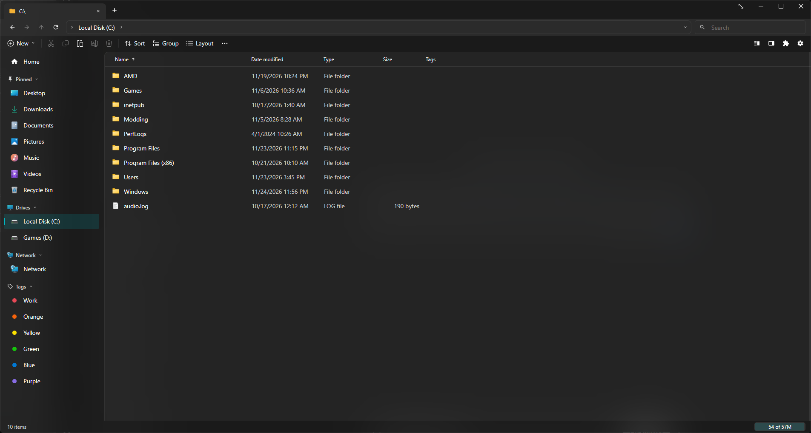
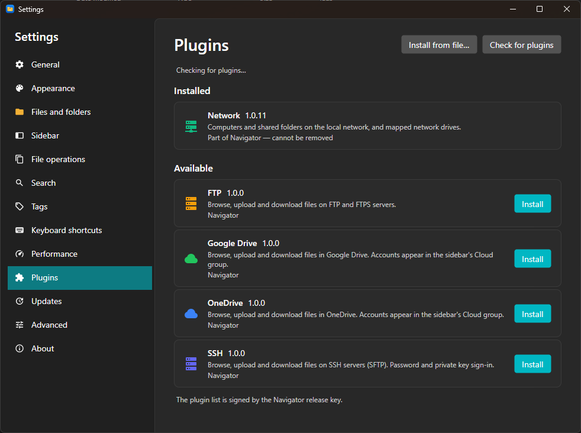
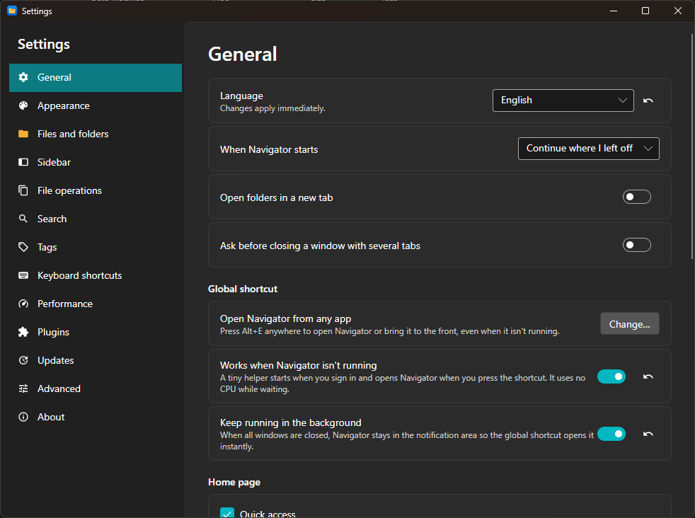
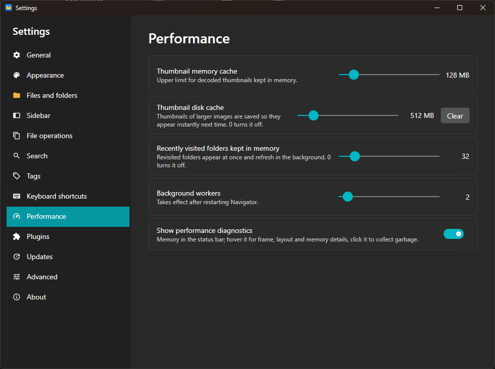
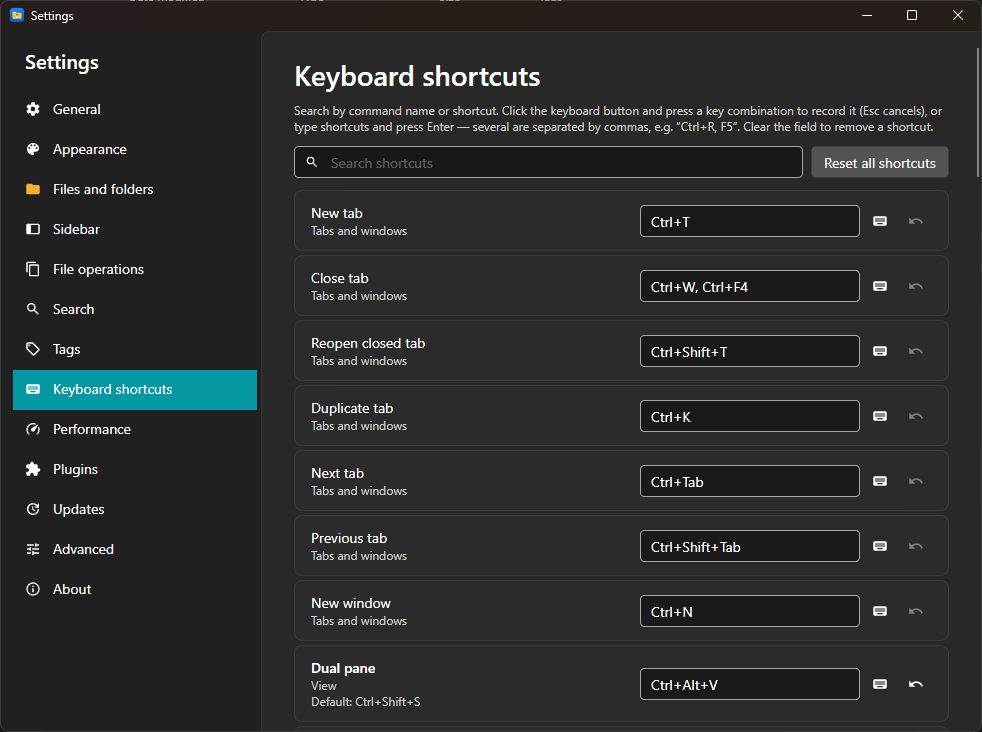
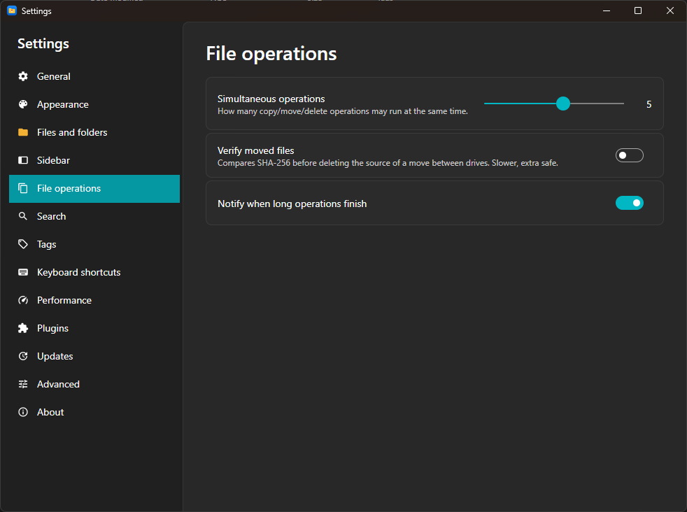

<div align="center">

# Navigator

**A modern, performance-focused, cross-platform file manager.**

Browse, organize and manage your local, network and cloud files from a single customizable workspace.

[](https://github.com/IgorBabayan/navigator/releases)
[](LICENSE)
[](https://dotnet.microsoft.com/)
[](https://avaloniaui.net/)


[Download](https://github.com/IgorBabayan/navigator/releases) · [Features](#features) · [Plugins](#plugins) · [Build from source](#build-from-source) · [Report an issue](https://github.com/IgorBabayan/navigator/issues)

</div>



## About

Navigator is an open-source desktop file manager built with .NET 10 and Avalonia UI 12. It combines a familiar tabbed interface with responsive navigation, configurable resource usage, reliable file operations and an extensible plugin system.

Its goal is to make everyday file management fast and comfortable without sacrificing advanced functionality or cross-platform portability.

## Features

### File management

- Tabbed browsing, multiple windows and dual-pane navigation.
- Breadcrumb navigation, pinned folders, drives and navigation history.
- Details, list, tiles and icon layouts with sorting, grouping and filtering.
- File name and content search, preview pane and file properties.
- Drag and drop, clipboard integration, color-coded tags and archive support (ZIP and TAR).
- Recycle Bin / Trash integration and file operation undo/redo where supported.

### Performance by design

- Virtualized file views and batched directory loading.
- Configurable memory and disk thumbnail caches.
- Recently visited folder cache with background refresh.
- Adjustable background worker count and coalesced filesystem monitoring.
- Optional diagnostics for memory, frame rate and rendering performance.

### Reliable file operations

- Concurrent copy, move and delete queues with adjustable limits.
- Progress reporting, transfer speed and estimated time remaining.
- Pause, resume, cancel, retry and conflict resolution.
- Optional SHA-256 verification before deleting the source of cross-drive moves.
- Completion notifications for long-running operations.

### Personalization and productivity

- Light and dark themes, accent colors, interface density and motion settings.
- Customizable keyboard shortcuts and command palette.
- Global activation shortcut and optional background operation (platform limitations may apply).
- Session restoration and settings import/export.
- English and Ukrainian localization.
- Built-in update mechanism using signed release manifests and integrity checks.

## Plugins

Extend Navigator through **Settings → Plugins**. The built-in Network plugin provides a starting point, while optional packages add remote and cloud storage providers.

| Plugin | Functionality | Type |
| --- | --- | --- |
| Network | Browse local network computers, shared folders and mapped drives | Built-in |
| FTP | Browse and transfer files over FTP and FTPS | Optional |
| SSH | Access SFTP servers with password or private-key authentication | Optional |
| Google Drive | Browse, upload and download cloud files | Optional |
| OneDrive | Browse, upload and download cloud files | Optional |

The plugin manager supports installation, updates and removal of optional plugins, a signed catalog and local `.navplugin` packages. Cloud accounts use browser-based sign-in and OS credential storage. Network discovery and other integrations may vary by operating system.



## Screenshots

| General settings | Performance settings |
| --- | --- |
|  |  |
| **Keyboard shortcuts** | **File operations** |
|  |  |

## Download and installation

Visit the [GitHub Releases page](https://github.com/IgorBabayan/navigator/releases) for available builds. The project defines the following package formats; availability depends on the published release.

| Platform | Package formats |
| --- | --- |
| Windows | Installer, portable ZIP |
| Linux | AppImage, tar.gz |
| macOS | DMG, ZIP |

Download the package matching your operating system and architecture. Run the installer or extract the portable package as appropriate. On Linux, an AppImage may need executable permission (`chmod +x <file>.AppImage`).

Navigator includes an automatic updater. See **Settings → Updates** to manage updates. If no release is available yet, build the application from source.

## Keyboard shortcuts

Shortcuts can be changed in **Settings → Keyboard shortcuts**, including recording key combinations and restoring defaults.

| Action | Example shortcut (Windows) |
| --- | --- |
| New tab | `Ctrl+T` |
| Close tab | `Ctrl+W` / `Ctrl+F4` |
| Reopen closed tab | `Ctrl+Shift+T` |
| Duplicate tab | `Ctrl+K` |
| Next tab | `Ctrl+Tab` |
| Previous tab | `Ctrl+Shift+Tab` |
| New window | `Ctrl+N` |

## Build from source

### Prerequisites

- [.NET 10 SDK](https://dotnet.microsoft.com/download/dotnet/10.0)
- [Git](https://git-scm.com/)
- Platform-specific Avalonia runtime dependencies where required.

```bash
git clone https://github.com/IgorBabayan/navigator.git
cd navigator
dotnet restore Navigator.slnx
dotnet build Navigator.slnx -c Release
dotnet test Navigator.slnx -c Release
```

The repository uses `global.json` to select the .NET SDK. Consult the project documentation for platform-specific packaging and launch instructions.

## Project structure

```text
navigator/
├── src/                 # Application source
├── plugins/             # Optional integrations
├── tests/               # Automated tests
├── installer/           # Installer configuration
├── assets/branding/     # Branding assets
├── docs/                # Project documentation
├── tools/               # Development tools
├── .github/workflows/   # CI and release automation
└── Navigator.slnx       # .NET solution
```

## Contributing

Contributions, bug reports and feature suggestions are welcome. Read [CONTRIBUTING.md](CONTRIBUTING.md) before submitting a pull request. For bug reports, include your OS, Navigator version and steps to reproduce the issue.

- [Report a bug or request a feature](https://github.com/IgorBabayan/navigator/issues)
- [View the changelog](CHANGELOG.md)
- [Plugin development documentation](docs/PLUGINS.md)

## License

Navigator is distributed under the [MIT License](LICENSE). See [THIRD-PARTY-NOTICES.md](THIRD-PARTY-NOTICES.md) for third-party acknowledgments.

---

<div align="center">

**Navigator — Your files. Your workspace. Your way.**

If you find Navigator useful, consider giving the repository a star.

</div>
